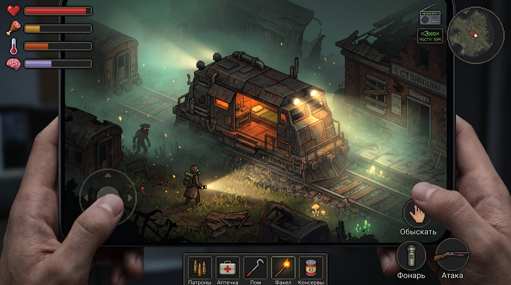
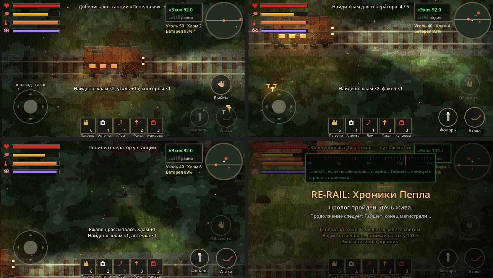

# RE-RAIL: Хроники Пепла

2D пиксель-арт выживание / RPG на Android (Godot 4.3, вид сверху 3/4).

Илья, пожилой машинист, едет на бронедрезине сквозь ядовитый туман «Пепельного
занавеса»: старое радио поймало голос дочери, пропавшей 10 лет назад.

| Макет (цель) | Пролог сейчас |
|---|---|
|  |  |

**Статус:** веха 1, пролог «Пепельная». Графика пока процедурная (рисуется кодом)
и рассчитана на замену нарисованными спрайтами того же размера.

## Что уже работает
- **Дрезина:** газ и задний ход джойстиком, уголь сгорает. Лампа дрезины — безопасная зона: тепло и рассудок восстанавливаются.
- **Высадка:** Илья ходит джойстиком, фонарь наводится вторым пальцем (мультитач).
- **Выживание:** здоровье, голод, тепло, рассудок, батарея фонаря. В темноте и тумане рассудок тает.
- **Ржавцы:** боятся света. Луч фонаря отгоняет их и сжигает, лом добивает.
- **Обыск:** кучи хлама дают лом, уголь, батарейки и предметы.
- **Предметы:** аптечка, консервы, факел (тепло и свет на минуту), лом. Патроны ждут ружья.
- **Радио-эхо:** ведите пальцем по шкале тюнера. Рядом с аномалией на своей частоте помехи расходятся, и проступают голоса прошлого.
- **Цель пролога:** починить генератор станции «Пепельная» (5 хлама) и поймать голос дочери на 103.7.
- **Звук целиком процедурный:** ветер, гул, двигатель, шаги, удары, рык, помехи, голос эха.

## Управление
| Где | Что |
|---|---|
| Левая половина экрана | джойстик: ходьба / газ дрезины |
| Правая половина экрана | наведение фонаря |
| Обыскать / Сесть / Выйти / Чинить | контекстная кнопка (обыск — удерживать) |
| Фонарь, Атака | вкл/выкл фонарь, удар ломом |
| Панель снизу | использовать предмет |
| Радио (справа сверху) | открыть тюнер |

## Разработка
```bash
godot --path .                              # запуск на ПК (мышь = палец)
godot --headless --path . -- --autoplay     # автоигрок проходит пролог; код 0 = успех
```
CI собирает APK на каждый push (Actions → Artifacts; с `main` — Releases).

## Структура
```
scripts/game.gd        мир, дрезина, Илья, выживание, ржавцы, радио — вся логика
scripts/hud.gd         сенсорный HUD по макету (мультитач)
scripts/pixel_art.gd   процедурные спрайты (заменяемы PNG)
scripts/sfx.gd         процедурный звук
shaders/ground.gdshader  трава, насыпь, шпалы, рельсы
shaders/fog.gdshader     ядовитый туман (мутный слой + подсвечиваемый слой)
tools/autoplay.gd      автоигрок для CI
docs/GDD.md, TASKS.md, CLAUDE.md, GEMINI.md
```
