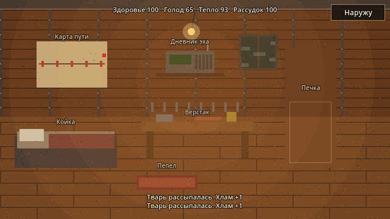
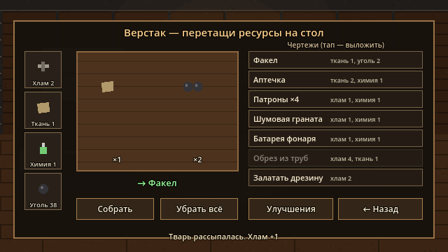
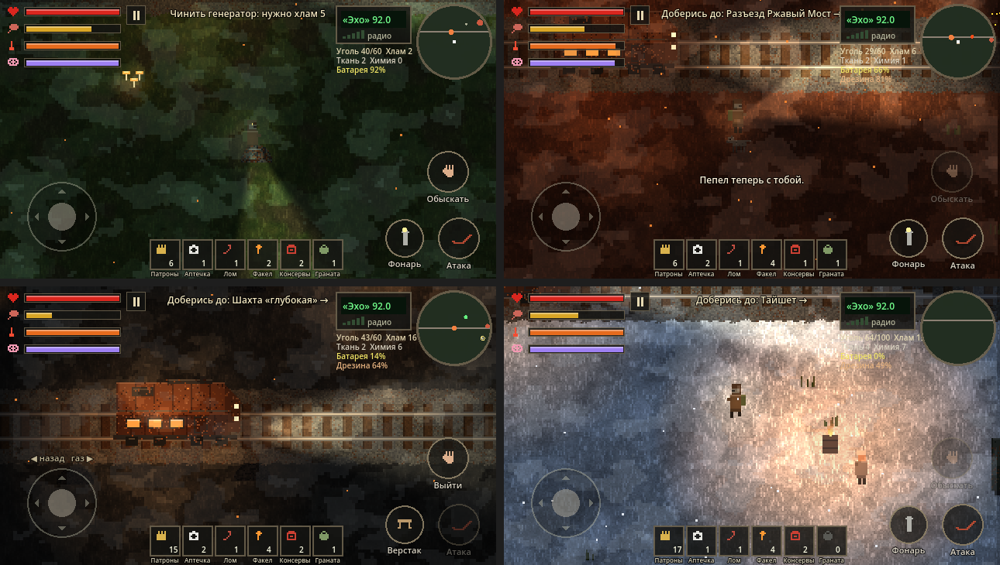

# RE-RAIL: Хроники Пепла

2D пиксель-арт выживание / RPG на Android (Godot 4.3, вид сверху 3/4).

Илья, пожилой машинист, едет на бронедрезине сквозь ядовитый туман «Пепельного
занавеса»: старое радио поймало голос дочери, пропавшей 10 лет назад.

| Макет (цель) | Пролог сейчас |
|---|---|
|  |  |

**Статус:** веха 2 — вся история целиком: 4 главы, финал с тремя концовками.
Графика пока процедурная (рисуется кодом) и рассчитана на замену нарисованными
спрайтами того же размера.

## Сюжет
| Глава | Биом | Новое | Цель |
|---|---|---|---|
| 1 · Пепельная | трава, зелёный туман | ржавцы, семья у костра (выбор) | починить генератор |
| 2 · Ржавый мост | ржавые болота | стайники, пёс Пепел, механик Вера, сейф с кодом из радио, светлячки | перевести стрелку |
| 3 · Угольная шахта | угольная пыль | ползуны (свет их не берёт), торговец Кузьмич, шахтёр под завалом (выбор) | открыть ворота тоннеля |
| 4 · Тайшет | снег, холод ×2 | все твари, старик у костра | оживить радиовышку → Аня |

Концовка зависит от **кармы**: помогал людям — «Светлая дорога», был ни плох ни хорош —
«Дорога домой», грабил замерзающих — «Ржавое сердце».

| Кабина дрезины | Верстак: перетаскивание | Биомы глав |
|---|---|---|
|  |  |  |

## Системы
- **Кабина** (кнопка «Внутрь» на стоянке): койка (сон: рассудок, здоровье, тепло), верстак, печка (уголь → тепло, консервы → похлёбка), дневник эха, карта пути, Пепел на коврике.
- **Верстак перетаскиванием:** тащи хлам, ткань, химию и уголь на стол, и он сам узнает рецепт. Тап по чертежу выкладывает всё нужное.
- **Музыка процедурная и адаптивная:** тема дороги (гитарный перебор, бас, губная гармошка, ля-минор), тема дома в кабине (музыкальная шкатулка), слой опасности (барабаны и тремоло), который нарастает, когда твари рядом.
- **Дрезина — дом:** газ и задний ход джойстиком, уголь (вместимость растёт с бункером), обшивка. Пустую дрезину твари грызут, её нужно латать.
- **Рецепты верстака:** факел, аптечка, патроны, шумовая граната, батарея, обрез из труб, латки.
- **Улучшения дрезины:** двигатель, обшивка, прожектор, печка, угольный бункер, турель (нужен чертёж Веры).
- **Выживание:** здоровье, голод, тепло (в Тайшете холод вдвое злее), рассудок, батарея фонаря.
- **Враги:** ржавец (боится света), стайник (быстрый, стаей по трое), ползун (бронированный, свет лишь замедляет его — бей ломом или из обреза).
- **Добрые существа:** пёс Пепел (лает на тьму, кусает тварей, чует хлам на миникарте), светлячки (рядом с ними возвращается рассудок).
- **Люди и выборы:** диалоги с ценой и последствиями, торговля.
- **Радио-эхо:** голоса прошлого дают подсказки и коды (сейф во 2-й главе), голос Ани ведёт по сюжету.
- **Оружие:** лом, обрез (шумный: выстрел приманивает тварей), шумовая граната оглушает стаю.
- **Меню и сохранения:** главное меню, пауза, настройки, автосохранение. Между главами сохраняется весь прогресс.
- **Звук целиком процедурный.**

## Управление
| Где | Что |
|---|---|
| Левая половина экрана | джойстик: ходьба / газ дрезины |
| Правая половина экрана | наведение фонаря |
| Обыскать / Говорить / Сесть / Выйти / Чинить / Сейф | контекстная кнопка (обыск — удерживать) |
| Внутрь (в дрезине на стоянке) | кабина: койка, верстак, печка, дневник, карта |
| Фонарь, Атака | вкл/выкл фонарь, удар ломом / выстрел из обреза |
| Панель снизу | предметы; тап по «Оружию» — сменить лом/обрез |
| Радио (справа сверху) | открыть тюнер |

## Разработка
```bash
godot --path .                              # запуск на ПК (мышь = палец)
godot --headless --path . -- --autoplay     # автоигрок проходит ВСЮ игру; код 0 = успех
# проверка сохранений: сохранить на фазе 7, затем загрузить и сравнить строки SAVE/LOAD
godot --headless --path . -- --autoplay --test-save --stop-after=7
godot --headless --path . -- --autoplay --test-save --continue
```
CI собирает APK на каждый push (Actions → Artifacts; с `main` — Releases).

## Структура
```
scripts/game.gd        мир главы, дрезина, Илья, выживание, твари, пёс, радио — вся логика
data/chapters.json     главы: биом, станция, цель, кучи, люди, эхо, план автоигрока
data/dialogs.json      диалоги и торговля
data/crafting.json     рецепты верстака и улучшения дрезины
scripts/hud.gd         сенсорный HUD по макету (мультитач)
scripts/menu.gd        меню, пауза, настройки, диалоги, торговля; общий «панельный» UI
scripts/interior.gd    кабина дрезины и верстак с перетаскиванием
scripts/music.gd       процедурная адаптивная музыка (дорога / дом / опасность)
scripts/pixel_art.gd   процедурные спрайты (заменяемы PNG)
scripts/sfx.gd         процедурный звук
shaders/ground.gdshader  трава, насыпь, шпалы, рельсы
shaders/fog.gdshader     ядовитый туман (мутный слой + подсвечиваемый слой)
tools/autoplay.gd      автоигрок для CI
docs/GDD.md, TASKS.md, CLAUDE.md, GEMINI.md
```
